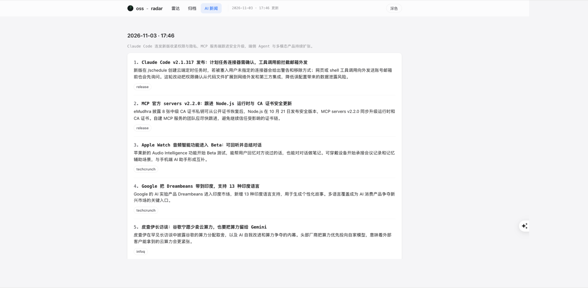
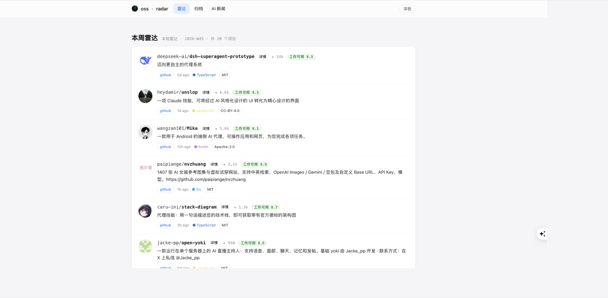

# oss-radar-intel

每天帮你盯三样东西：

- **AI 新闻**：5-8 条，中文标题 + 两句摘要 + 真实来源
- **热门论文**：HuggingFace 每日热榜，默认 2 篇
- **新开源项目**：GitHub 近期涨起来的 AI 项目

抓完直接生成一个本地网页，也可以每天定时推到飞书。



## 30 秒开始

需要 **Node.js 20.11 或更高版本**。不需要数据库，不需要 `npm install`，不需要 LLM key。

```bash
# 1. 安装
bash install.sh
# 或者手动复制：cp -R oss-radar-intel ~/.claude/skills/

# 2. 在 Claude Code 里输入斜杠命令
/oss-radar-intel
```

安装后 `/oss-radar-intel` 就是入口；也可以直接说“帮我看看今天有什么 AI 新闻、论文和开源项目，要中文的”。agent 会自己读 `SKILL.md`，跑抓取、写中文、打开网页。

也可以不用 agent，直接命令行：

```bash
cd ~/.claude/skills/oss-radar-intel
node scripts/quick.mjs
```

它会用默认值抓一次，起本地网页并打开浏览器。

## 它长什么样

雷达页：本周项目卡片，带 star、语言、license 和中文一句话介绍。



AI 新闻页：一句综述 + 5-8 条中文新闻 + 2 篇论文。

## 常用操作

```bash
# 一键出结果，默认 AI / Agent / MCP，论文 2 篇
node scripts/quick.mjs

# 只抓某一类
node scripts/fetch.mjs news
node scripts/fetch.mjs papers
node scripts/fetch.mjs repos

# 抓完合并 agent 写的中文内容
node scripts/apply-content.mjs /tmp/content.json

# 本地网页看历史
node scripts/serve.mjs

# 环境检查
node scripts/doctor.mjs
```

## 配置

第一次想让 agent 帮你正式配置，说：

> 帮我配置 oss-radar-intel，每天 11 点发 AI 新闻、RAG 论文和 MCP/Agent 项目到飞书。

它会分别问新闻、论文、项目方向、时间、推送方式和条数，然后写配置、发测试消息、当场跑一次。

也可以自己跑：

```bash
node scripts/setup.mjs
```

配置存在 `~/.oss-radar-intel/config.json`，改了随时重跑。

## 定时推送

默认不装定时任务。确认结果没问题后：

```bash
node scripts/schedule.mjs --install
```

macOS 写 launchd，Linux 写 crontab，每天按配置时间抓取并推送。想停掉：

```bash
node scripts/schedule.mjs --remove
```

## 飞书推送

默认用机器人应用：需要 appId、appSecret 和群 chatId。应用需要开 `im:message:send_as_bot` 权限，机器人要拉进群。

也可以用更简单的自定义机器人 webhook：群设置 → 群机器人 → 添加机器人 → 自定义机器人。

不推送，只存本地也可以。

## 中文是怎么来的

CLI 只负责抓原始数据，抓到的是英文。

中文由你的 **agent 自己** 翻译和改写，不需要配置 LLM：

1. agent 读报告 JSON
2. 按 oss-radar 的新闻格式写 `content.json`
3. `apply-content.mjs` 合并回报告
4. 网页刷新就是中文

`apply-content.mjs` 会强制收敛：新闻最多 8 条、每条必须有中文标题、两句摘要和真实来源。

## 数据源

- 新闻：Hacker News、InfoQ、少数派、爱范儿、TechCrunch
- 产品更新：GitHub Releases（Claude Code / Codex / Cursor / DeepSeek / Qwen 等）
- 新项目：GitHub Trending（llm / ai-agent / mcp / ai-coding 等 topic）
- 论文：HuggingFace Daily Papers

单个源失败只跳过并在页面标注，不影响其他源。

## 已知限制

- Bing News RSS 上游已停止提供 RSS，会显示不可用
- GitHub 匿名额度 10 次/分钟；设置 `GITHUB_TOKEN` 或本机登录 `gh` 会更稳
- 网页只做展示和归档，不含团队配置和试跑
- RSS 源只含最新条目，无法按日期回溯

## 文件

```
install.sh               一键安装到 ~/.claude/skills
SKILL.md                 agent 入口（斜杠：/oss-radar-intel）
scripts/quick.mjs        一键出结果
scripts/setup.mjs        配置向导
scripts/doctor.mjs       环境检查
scripts/fetch.mjs        抓取
scripts/run-daily.mjs    定时入口
scripts/apply-content.mjs 合并中文
scripts/schedule.mjs     定时任务
scripts/serve.mjs        本地网页
scripts/lib/             数据源和渲染
web/                     雷达 / 归档 / AI 新闻页面
```

## License

MIT
